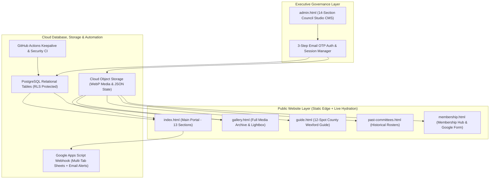

# Enniscorthy Indian Association (EIA) - Complete Project Implementation & Architecture Report

**Client:** Enniscorthy Indian Association (Formerly Keralites in Enniscorthy)  
**Registration:** Wexford Public Participation Network (PPN-00656) | Sports & Arts Club (PPN-00677)  
**Established:** 23 January 2017 | **Headquarters:** 13 Market Square, Enniscorthy, Co. Wexford (Eircode: Y21 K449)  
**Document Purpose:** End-to-End Technical Architecture, Feature Breakdown, Security Audit, and Operations Handover Report

---

## 1. Executive Summary

The Enniscorthy Indian Association (EIA) digital platform is a custom-engineered, high-performance web application and content management ecosystem built to represent over 250 Indian families and community members across County Wexford, Ireland.

The platform combines instant static edge delivery with a live cloud database and a 14-module Executive Administration Portal. Every public section of the website (Hero Video, About Story, Lifetime Trustees, Executive Committee, Past Committees Archive, Four Cultural Pillars, Local Wexford Guide, Impact Statistics, Festival & Event Calendar, Native Event RSVPs, Membership Hub, Community Services, Photo & Video Gallery, Member Voices Testimonials, Sponsors, and Global Settings) can be managed dynamically without code changes.

---

## 2. System Architecture & Technology Stack

### Core Technical Pillars
1. **Frontend Engineering:** Zero-dependency semantic HTML5, custom CSS3 design system (`--forest`, `--amber`, `--cream`, `--charcoal`), and modular ES6+ JavaScript. Typography uses *Fraunces* (editorial serif), *Plus Jakarta Sans* (interface sans), and *IBM Plex Mono* (technical metadata).
2. **Dual-Layer Resilience (Instant Static + Live Cloud Hydration):** Every page ships with complete pre-rendered baseline HTML for instant First Contentful Paint (FCP) and full SEO indexing, followed by asynchronous cloud hydration that seamlessly injects the latest Executive Committee updates.
3. **Client-Side WebP Media Engine:** Images uploaded in the Admin Portal are automatically cropped, resized, and compressed into `.webp` format in the browser using HTML5 Canvas before cloud upload, keeping page weight minimal.
4. **Dual-Write Persistence:** Critical collections write simultaneously to relational PostgreSQL tables and cloud JSON state blobs (`site_content.json`, `gallery_meta.json`, `current_committee.json`, `site_settings.json`), guaranteeing zero data loss on refresh.

---

## 3. Page-by-Page Implementation Breakdown

### 3.1 Main Public Portal ([index.html](file:///Users/sandeepjohn/eia/index.html))
The flagship landing page is structured into 13 cohesive sections:
* **Global Navigation Header:** Responsive sticky navigation bar with mobile slide-out drawer, active section tracking, and a dynamic primary CTA button (`Join EIA 2026`) wired directly to the official Google Form (`https://forms.gle/G4cXah5Pa3G1YG9y7`) and synchronized with the Association Year controller.
* **Section 1 - Hero Video & Impact Counters:** Full-bleed background video (`images/hero-video.mp4`) with fallback poster (`images/hero-bg.webp`), PPN registration badge, headline typography, dual CTA buttons, and 4 animated statistics counters (`15 Executive Leaders`, `250+ Families & Friends`, `12+ Annual Gatherings`, `100% Inclusive & Welcoming`).
* **Section 2 - About Us & Heritage Story:** Chronicles EIA's history since 23 January 2017, its evolution from *Keralites in Enniscorthy*, PPN registrations (`PPN-00656` and `PPN-00677`), and community integration across County Wexford.
* **Section 3 - Leadership & Executive Committee:**
  * **Lifetime Trustees (`#trusteesGrid`):** Dedicated memorial and honour cards for Lifetime Trustees (including the late Biju V Sreedharan with a dedicated memorial badge, Bindu Biju, and Bino Varavumkal).
  * **Executive Committee (`#commGrid`):** Dynamic grid displaying the 15 current officers and committee members (Patron Dr. George Leslie, President Siby Varghese, Vice President Daisy David, Secretary Denil Thomas, Treasurer Abin Varghese, Joint Secretary Akhila Jose, Joint Treasurer Nisha Renjith, PRO Jobi Mathew, and Executive Members), plus a direct link to the historical archive.
* **Section 4 - Four Core Pillars (`#pillarsGrid`):** Interactive cards detailing *Cultural Festivals & Arts*, *EIA Sports & Arts Club*, *Community Support & Integration*, and *Youth & Next-Generation Programs*.
* **Section 5 - Local Wexford Guide Preview:** Teaser showcase of Enniscorthy landmarks linking to the full 12-destination guide.
* **Section 6 - Impact Statistics Band:** High-contrast dark emerald band highlighting community metrics.
* **Section 7 - Events & Festivals Calendar (`#eventGrid`):** Displays upcoming celebrations (Onam, Diwali, Christmas & New Year, St. Patrick's Day Parade, Annual Sports Meet, and AGM) with date badges, time, venue, and dual-mode RSVP buttons (Native RSVP Modal or external link).
* **Section 8 - Membership Hub:** Outlines Family, Individual, and Student/Senior membership benefits with direct redirection to the official Google Form.
* **Section 9 - Community Services (`#servicesGrid`):** Details new-arrival orientation, family support, cultural workshops, and civic representation.
* **Section 10 - Curated Photo & Video Gallery Preview (`#galGrid`):** Strictly capped at 6 curated items on the homepage to maintain visual clarity and fast load speed, paired with a prominent **View Full Photo & Video Gallery** button linking to [gallery.html](file:///Users/sandeepjohn/eia/gallery.html).
* **Section 11 - Member Voices Carousel (`#testGrid`):** Automatic smooth-scrolling carousel advancing every 3.5 seconds (`3500ms`), complete with manual previous/next arrows, pagination dots, pause-on-hover, and mobile touch-swipe support.
* **Section 12 - Partners & Sponsors:** Showcases official institutional partners (Wexford County Council, Wexford PPN) and community sponsors (*IreAsia Oriental Supermarket*, *The Holy Grail Restaurant*).
* **Section 13 - Contact & General Enquiry Hub + Footer:** Interactive contact form connected to both the cloud database and the Google Sheets webhook (`Enquiries` tab), alongside complete association address, phone (`+353 89 989 7110`), email (`enniscorthyindianassociation@gmail.com`), and copyright metadata.

---

### 3.2 Full Photo & Video Gallery ([gallery.html](file:///Users/sandeepjohn/eia/gallery.html))
* Displays the complete archive of community photographs and `.mp4` video performances without cluttering the homepage.
* Merges live uploads from the PostgreSQL `public.gallery` table, `gallery_meta.json` cloud storage metadata, and baseline archival media.
* Includes category filter pills (*All Memories*, *Onam & Festivals*, *Culture & Arts*, *Sports & Activities*, *Enniscorthy*), a live item counter, and a keyboard-accessible full-screen Lightbox supporting both high-resolution WebP photos and HTML5 video playback.

---

### 3.3 Local Enniscorthy & County Wexford Guide ([guide.html](file:///Users/sandeepjohn/eia/guide.html))
* Comprehensive 12-attraction newcomer and visitor journal covering *Enniscorthy Castle*, *Vinegar Hill*, *National 1798 Rebellion Centre*, *St. Aidan's Cathedral*, *River Slaney Walk*, *Enniscorthy Town Playground*, *Irish National Heritage Park*, *Secret Valley Wildlife Park*, *Wells House & Gardens*, *Johnstown Castle Estate*, *Curracloe Beach & Raven Wood*, and *Ferns Castle*.
* Features category filtering (*Within 5 km*, *History & Castles*, *Nature & Beaches*, *Family & Kids*, *Day Trips*), live search, travel distance widget from Market Square, half-day/full-day itineraries, and public transport links (Irish Rail, Wexford Bus, Bus Eireann).

---

### 3.4 Past Executive Committees Archive ([past-committees.html](file:///Users/sandeepjohn/eia/past-committees.html))
* Interactive historical directory preserving past leadership rosters by year (2025, 2024, and future archived years).
* Dynamically hydrates from `past_committees.json` in cloud storage so new rosters archived from the Admin Portal appear automatically.

---

### 3.5 Membership Hub ([membership.html](file:///Users/sandeepjohn/eia/membership.html))
* Dedicated membership information portal detailing association governance, community privileges, and tier structures, with all registration CTAs wired to the official Google Form (`https://forms.gle/G4cXah5Pa3G1YG9y7`) and synced with the global Association Year setting.

---

### 3.6 Executive Administration Portal ([admin.html](file:///Users/sandeepjohn/eia/admin.html))
A full-featured 14-section visual Content Management Studio built for the Executive Committee:
1. **Clean, Zero-Glass Centered Authentication Screen:** Solid architectural card (`#1C1917` on `#12100E`), zero printed credentials, password visibility toggle, persistent session option, and a **3-Step Email Verification Code Password Reset** flow.
2. **3-Step Email Verification Password Change Modal:** Requires sending a one-time verification code to the registered committee email (`enniscorthyeia@gmail.com`), verifying the code against the authentication server, and only then unlocking the *New Password* and *Confirm New Password* fields.
3. **14 Section Editors with Live Visual Previews:**
   * *Section 1:* Hero Section Studio (video URL, poster upload, headline, counters)
   * *Section 2:* About Us Studio (story paragraphs, milestones, feature photo with interactive cropper)
   * *Section 3:* Executive Committee & Lifetime Trustees Manager (add, edit, reorder, crop square portraits, delete)
   * *Section 3B:* Past Committees Archive Manager (manage historical years and 1-click archive current committee)
   * *Section 4:* Four Core Pillars Editor
   * *Section 5:* Local Wexford Guide Editor (all 12 destinations)
   * *Section 6:* Stats Band Editor
   * *Section 7:* Events & Festivals Manager (create/edit events, toggle Native RSVP vs External Link, upload event posters)
   * *Section 8:* Membership Hub Editor (tier pricing, features, Google Form link)
   * *Section 9:* Community Services Editor
   * *Section 10:* Photo & Video Gallery Manager (drag-and-drop upload, interactive WebP cropper, category tagging, dual-write persistence)
   * *Section 11:* Member Voices Testimonials Manager
   * *Section 12:* Partners & Sponsors Manager
   * *Section 13:* Global Header, Association Year Cascade Controller, & Footer Settings
   * *Section 14:* RSVPs & General Enquiries Hub (separated tabs for Event RSVPs and General Enquiries, guest counter, search filter, 1-click CSV spreadsheet export, and direct Google Sheet shortcut)

---

## 4. Database Schema, Cloud Storage & Google Sheets Integration

### 4.1 Relational PostgreSQL Tables
| Table Name | Primary Key | Purpose & Key Columns | Access Policy (RLS) |
| :--- | :--- | :--- | :--- |
| `public.committee_members` | `id` (`bigint`) | Stores Lifetime Trustees and Executive Committee (`name`, `role`, `type`, `photo_url`, `display_order`) | Public `SELECT`; Authenticated Executive `INSERT / UPDATE / DELETE` |
| `public.events` | `id` (`text`) | Stores festival and event listings (`title`, `date`, `display_day`, `display_month`, `time`, `badge`, `location`, `description`, `image_url`, `rsvp_enabled`, `rsvp_mode`, `rsvp_link`) | Public `SELECT`; Authenticated Executive `INSERT / UPDATE / DELETE` |
| `public.gallery` | `id` (`text`) | Stores gallery photo and video metadata (`url`, `caption`, `category`, `created_at`) | Public `SELECT`; Authenticated Executive `INSERT / UPDATE / DELETE` |
| `public.event_rsvps` | `id` (`bigint`) | Stores public Event RSVPs and General Enquiries (`event_id`, `event_title`, `guest_name`, `email`, `phone`, `attendees`, `member_status`, `notes`, `created_at`) | Public `INSERT`; Authenticated Executive `SELECT / DELETE` |

### 4.2 Cloud Storage JSON State Files (`gallery` Bucket)
* `site_content.json` and `site_cms.json`: Stores Hero, About, Pillars, Guide, Stats, Membership, Services, Partners, and Footer content.
* `site_settings.json`: Stores global `associationYear`, navigation CTA text, and contact details.
* `current_committee.json` and `past_committees.json`: Stores current and historical committee rosters.
* `gallery_meta.json`: Synchronized metadata mirror of all gallery photos for instant CDN edge reads.
* `testimonials.json`: Stores Member Voices quotes and author attributions.

### 4.3 Multi-Tab Google Sheets Webhook ([scripts/google_sheet_enquiries.gs](file:///Users/sandeepjohn/eia/scripts/google_sheet_enquiries.gs))
* Connected to Google Spreadsheet ID `1mMdxPxdrZawase1gtK2R7CZhwgHrzxcZ_uCZJ5gDg7E`.
* Automatically routes incoming submissions by payload `type`:
  * **Tab 1 (`Enquiries`):** Captures general website contact form messages (`Timestamp`, `Name`, `Email`, `Message`, `UserAgent`).
  * **Tab 2 (`Event_RSVPs`):** Captures event registrations (`Timestamp`, `Event Title`, `Guest Name`, `Email`, `Phone`, `Guests Count`, `Member Status`, `Dietary / Notes`).
* Dispatches instant email notifications via `MailApp.sendEmail` to `enniscorthyindianassociation@gmail.com`.

---

## 5. Free-Tier Database Keepalive Architecture

To prevent the free-tier cloud database from pausing due to 7 days of inactivity, a redundant two-layer keepalive system is active:
1. **Serverless GitHub Actions Cron ([.github/workflows/keepalive.yml](file:///Users/sandeepjohn/eia/.github/workflows/keepalive.yml)):** Runs automatically every 12 hours (`0 */12 * * *`) on GitHub's servers, executing a lightweight read query (`GET /rest/v1/events?select=id&limit=1`) that registers database activity 24/7 even if zero visitors open the website.
2. **Client-Side Background Heartbeat:** Built into [index.html](file:///Users/sandeepjohn/eia/index.html) and [admin.html](file:///Users/sandeepjohn/eia/admin.html) to ping the database every 4 minutes while a browser tab remains open.

---

## 6. Security & Vulnerability Audit Summary

An automated security verification suite ([scripts/security_test_suite.py](file:///Users/sandeepjohn/eia/scripts/security_test_suite.py)) and continuous integration workflow ([.github/workflows/security-audit.yml](file:///Users/sandeepjohn/eia/.github/workflows/security-audit.yml)) enforce 34 security checks across 5 domains:

| Security Domain | Controls Implemented | Audit Status |
| :--- | :--- | :--- |
| **1. Secret & Credential Hygiene** | `.env` excluded via `.gitignore`; zero `service_role` keys, `sb_secret` keys, or plaintext passwords in any client-side or git-tracked file. | **PASSED (2/2)** |
| **2. Authentication & 3-Step OTP Reset** | Password changes and resets require email OTP verification (`POST /auth/v1/recover` -> `POST /auth/v1/verify` -> `PUT /auth/v1/user`). Unauthenticated password updates and invalid tokens are rejected with HTTP 401/403. | **PASSED (5/5)** |
| **3. Database Row-Level Security (RLS)** | Anonymous `INSERT` and `DELETE` operations on `events`, `committee_members`, and `gallery` are strictly blocked at the PostgreSQL engine layer. | **PASSED (9/9)** |
| **4. Cloud Storage Access Control** | Anonymous unauthenticated file uploads to the `gallery` bucket are rejected. Only authenticated executive sessions can upload media. | **PASSED (1/1)** |
| **5. DOM XSS & Reverse Tabnabbing** | `escapeHtml()` sanitizes dynamic database strings across all pages; all external `target="_blank"` links enforce `rel="noopener noreferrer"`; zero emojis or em dashes across all pages. | **PASSED (17/17)** |

> [!TIP]
> **Running the Security Audit Locally:**
> Execute `python3 scripts/security_test_suite.py` from the project root at any time to run all 34 live and static security assertions.
>
> **Email Template Note for 6/8-Digit OTP Display:**
> In the cloud database dashboard under *Authentication -> Email Templates -> Reset Password*, ensure the template body includes `{{ .Token }}` so recipients see the numeric verification code directly in the email body. The verification input in [admin.html](file:///Users/sandeepjohn/eia/admin.html) supports both the numeric `{{ .Token }}` code and verification links/tokens automatically.
